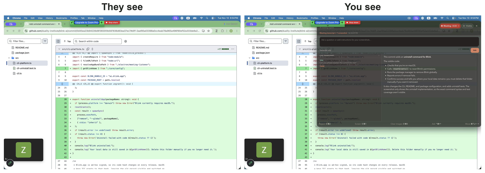

# Blink

Blink is an **AI meeting copilot for macOS with built-in privacy mode**. In a nutshell:

- Get answers to questions about your screen or a live meeting in a floating popup that only you can see, using screenshots and meeting transcripts as context.
- Choose your own AI backend, with support for the **Claude Code**, **Codex**, and **OpenCode**.
- Blink is **fully free and open source**.

[](assets/meeting-privacy.png)

## Get started

You need macOS, [Bun](https://bun.sh/), and one installed,
authenticated backend: [Claude Code](https://code.claude.com/docs/en/setup),
[Codex](https://developers.openai.com/codex/cli), or [OpenCode](https://opencode.ai/docs).

To install:

```bash
bunx @dualityinstitute/blink-ai@latest install
```

Setup lets you choose a backend. You can switch later from the tray's **Backend** menu or with `blink-ai configure`.

Then start the app:

```bash
blink-ai
```

Claude Code and Codex use their CLI's configured model. When you choose OpenCode,
Blink keeps your saved model or uses the default `model` configured in OpenCode
on this machine. Setup checks that `opencode models` lists it before saving.

To change Blink's OpenCode model, run the commands below. Copy a vision-capable
`provider/model` ID from the list and paste it at the prompt:

```bash
opencode models
blink-ai set-model
```

You can also pass the ID directly: `blink-ai set-model provider/model`. Restart
Blink to apply the change. This doesn't change OpenCode's own default.

If setup can't find an available default, edit Blink's `config.json` at the path
shown in the error (normally `~/.blink-ai/config.json`). Set `"backend": "opencode"`
and `"model"` to the ID you copied, then rerun install. Alternatively, pass
`--backend opencode --model provider/model` to the install command.

## First launch setup

1. In **Welcome to Blink**, allow **Screen & System Audio Recording** and
   **Microphone**. In **System Settings → Privacy & Security**, enable Blink in
   both permission panels.
2. Return to Blink and click **Check access**. Confirm both permissions are green
   and show **All set**.
3. Click **Restart Blink** to finish setup and apply the permissions.

You can reopen this screen from **Permissions → Setup Assistant…** in the
menu-bar menu.

## Using Blink

1. Choose **Monitor** for screenshots and typed questions, or **Meeting** to add
   a live transcript of the meeting.
2. Type a message and/or capture screenshot.
3. Select **Ask** to send the ready context. Follow-up questions keep the
   conversation; **Stop** stops the request in progress.

| Action | Shortcut |
| --- | --- |
| Capture a region | `⇧⌘2` |
| Capture the main display | `⇧⌘1` |
| Clear staged screenshots | `⇧⌘0` |
| Ask | `⌃⌘Return` or `⇧⌘Return` |

Choose **Off** to stop capture and end the conversation. The tray also opens
Presenter Notes, answer history, saved transcripts, and permission settings.

## Privacy and data

The eye toggle controls visibility:

- **Private** (default) turns on capture protection for the popup and Presenter
  Notes while keeping them visible to you. The menu-bar icon also become hidden.
- **Visible** lets Blink appear normally in screenshots and screen sharing.

**Capture protection test:** test your sharing tool is highly recommended before relying on
Private mode.

- Context is sent to the selected backend when you **Ask**. Its model
  provider may process it remotely.
- Settings, answer history, transcripts, and saved screenshots live under
  `~/.blink-ai/`. Saved screenshots and transcripts remain until you delete them.
- Presenter Notes stay local.

**Use Blink responsibly and at your own risk.**

## Uninstall

Quit Blink from its menu, then run:

```bash
blink-ai uninstall
```

This revokes Blink's macOS permissions and removes its global Bun package.
Your local data in `~/.blink-ai/` is kept. Delete that folder manually if you
no longer need your settings, transcripts, screenshots, and other saved data.

## License

[Apache-2.0](LICENSE).
